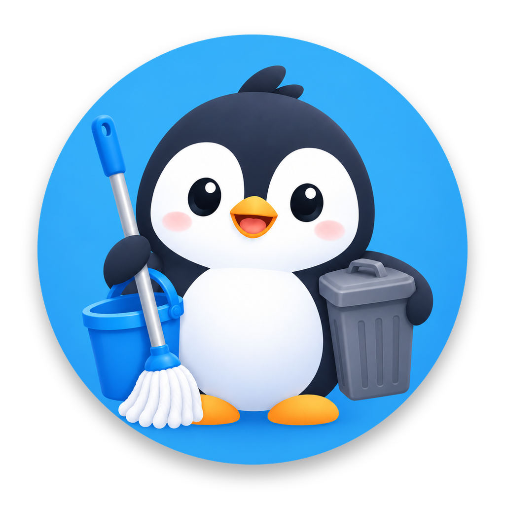

<p align="center">
  
</p>

<h1 align="center">Dọn Máy</h1>

<p align="center">Công cụ dọn dung lượng cho máy Mac của người làm iOS: Xcode, Simulator, Claude CLI, Figma, Pencil, trình duyệt Zen và các thư mục cá nhân.</p>

---

## Mục lục

- [Dọn Máy làm được gì](#dọn-máy-làm-được-gì)
- [Yêu cầu](#yêu-cầu)
- [Khởi chạy](#khởi-chạy)
- [Cấp quyền lần đầu](#cấp-quyền-lần-đầu)
- [Hướng dẫn sử dụng](#hướng-dẫn-sử-dụng)
- [Cách dọn và khôi phục](#cách-dọn-và-khôi-phục)
- [Những vị trí được quét](#những-vị-trí-được-quét)
- [Kiểm tra từ dòng lệnh](#kiểm-tra-từ-dòng-lệnh)
- [Cấu trúc mã nguồn](#cấu-trúc-mã-nguồn)
- [Thêm một vị trí dọn mới](#thêm-một-vị-trí-dọn-mới)
- [Giới hạn đã biết](#giới-hạn-đã-biết)

## Dọn Máy làm được gì

- **Quét** các vị trí hay phình to của công cụ lập trình và thiết kế, đo dung lượng thật trên đĩa.
- **Xếp mức an toàn** cho từng mục: *An toàn* (tự tạo lại), *Cần cân nhắc* (xoá được nhưng có ảnh hưởng), *Nên giữ* (không cho chọn).
- **Phát hiện chỗ tăng bất thường** dựa trên dung lượng tệp được ghi mới trong 24 giờ và 7 ngày. Mũi tên đỏ là tăng bất thường, cam là đang tăng.
- **Dọn có lịch sử**: mục tự tạo lại được thì xoá hẳn; dữ liệu không tự tạo lại được thì nén trước khi xoá và khôi phục được trong 7 ngày.
- **Theo dõi hiệu năng**: RAM, CPU, GPU, ổ đĩa và các tiến trình ngốn tài nguyên.
- **Dọn Thùng rác** với một bước xác nhận.

## Yêu cầu

| | |
| --- | --- |
| macOS | 14 Sonoma trở lên |
| Công cụ build | Xcode 15 trở lên hoặc Command Line Tools có Swift 5.10+ |
| Tuỳ chọn | Xcode (để quét Simulator bằng `xcrun simctl`) |

## Khởi chạy

### Cách 1 — đóng gói thành ứng dụng (khuyên dùng)

```bash
git clone git@github.com:HieuLeNguyen/DonMay.git
cd DonMay
scripts/build-app.sh
open build/DonMay.app
```

`scripts/build-app.sh` build bản release, đóng gói `build/DonMay.app` kèm biểu tượng và ký ad-hoc. Muốn dùng lâu dài thì kéo `DonMay.app` vào `/Applications`.

Script ký với danh tính theo bundle id (`designated => identifier "studio.thapp.donmay"`), nên **quyền đã cấp được giữ qua các lần build lại**. Ký ad-hoc mặc định gắn danh tính với mã băm của tệp chạy: mỗi lần build là một ứng dụng mới trong mắt macOS và bị hỏi quyền lại. Có chứng chỉ Developer ID riêng thì chạy `SIGN_IDENTITY="Developer ID Application: …" scripts/build-app.sh`.

### Cách 2 — chạy thẳng khi phát triển

```bash
swift run DonMay
```

Mở bằng Xcode: `open Package.swift`, chọn scheme **DonMay**, bấm Run.

## Cấp quyền lần đầu

| Quyền | Khi nào macOS hỏi | Để làm gì |
| --- | --- | --- |
| Desktop, Documents, Downloads | Lần quét đầu tiên | Tìm ảnh chụp màn hình cũ, bộ cài, bản tải trùng, thư mục build trong dự án. **Việc quét chờ tới khi Ngài bấm Cho phép.** |
| Full Disk Access | Không tự hỏi — ứng dụng có nút *Mở cài đặt* | Quét bản cài lên iPhone thật của Xcode (nằm trong container của ứng dụng khác) và đo Thùng rác. Có quyền này thì macOS không hỏi quyền thêm lần nào. |
| Điều khiển Finder | Lần đầu bấm *Dọn Thùng rác* | Dọn Thùng rác qua Finder. |

Không cấp Full Disk Access thì mọi tính năng khác vẫn chạy; thẻ Thùng rác chỉ ghi "Cần quyền Full Disk Access để đo".

## Hướng dẫn sử dụng

1. **Tổng quan** — mở ứng dụng là quét ngay. Màn đầu trả lời "cái gì đang tăng":
   - **vòng ổ đĩa** với dung lượng còn trống (đỏ khi dưới 10%) và nút *Chọn dọn an toàn*;
   - **Ghi mới 7 ngày qua**: tổng dung lượng được ghi thêm và thanh cho từng ứng dụng, sắp từ nhiều tới ít; `^^` đỏ là tăng bất thường, `^` cam là đang tăng;
   - **Theo nhóm**: thẻ từng ứng dụng với dung lượng, mức tăng và tỉ lệ an toàn / cân nhắc;
   - **Cảnh báo**: ổ gần đầy, ba chỗ tăng mạnh nhất, thiếu Full Disk Access, máy chạy quá 7 ngày chưa khởi động lại. Bấm một cảnh báo để mở đúng chỗ cần xử lý.
2. **Chọn mục** — bấm *Chọn N mục* để chọn mọi mục an toàn, hoặc vào từng nhóm ở thanh bên và tick từng mục. Mục *Nên giữ* không tick được.
3. **Dọn** — thanh dưới cùng cho biết sẽ lấy lại bao nhiêu. Bấm *Dọn các mục đã chọn*, xem lại hộp xác nhận:
   - các mục cần cân nhắc và lý do;
   - mục sẽ được nén sao lưu, mục xoá không sao lưu;
   - mục **không hoàn tác được** (máy ảo, runtime) — phải gõ `XOÁ` để xác nhận;
   - ứng dụng nên thoát trước khi dọn (Zen, Figma, Pencil).
4. **Lịch sử dọn** — xem từng lần dọn, khôi phục bản nén, hoặc xoá bản nén để lấy lại chỗ.
5. **Hiệu năng** — RAM, CPU, GPU cập nhật mỗi 2 giây, và các tiến trình dùng nhiều CPU nhất.

**Bấm vào một mục** (ở danh sách hay ở khối *Chỗ đang phình to*) để mở màn chi tiết: vì sao mục được xếp mức đó, phần ghi mới 24 giờ / 7 ngày, dùng lần cuối, dọn thì mất gì, các đường dẫn kèm nút *Hiện trong Finder*, và **12 thành phần lớn nhất bên trong** (nhấp đúp để mở trong Finder). Tick ô bên trái để chọn dọn mà không mở chi tiết.

**Chọn từng phần bên trong.** Màn chi tiết liệt kê mọi thứ nằm ngay bên trong mục (ví dụ từng ứng dụng trong *Bản cài lên iPhone thật*, từng dự án trong DerivedData), mỗi dòng một ô tick, kèm dung lượng và lần sửa cuối. *Chọn tất cả* / *Bỏ chọn tất cả* ở đầu danh sách; phần bỏ tick được giữ lại khi dọn. Nút cuối màn đổi theo lựa chọn: *Chọn dọn cả 19,4 GB*, *Chọn dọn 5 phần · 8,2 GB* hoặc *Không dọn mục này*. Mục chỉ dọn một phần hiện nhãn *Dọn N phần* trong danh sách. Mục có sao lưu nén thì mỗi phần được nén riêng để khôi phục từng phần.

**Thông tin máy.** Bấm logo ở đầu thanh bên để xem: tên và mã máy, chip, RAM, phiên bản macOS, dung lượng ổ đĩa, lúc khởi động, thời gian chạy liên tục, lần tắt máy gần nhất, và trạng thái *Cập nhật macOS* — có bật tự tải / tự cài không, lần kiểm tra gần nhất, bản đang chờ cài, dung lượng bản cập nhật đã tải sẵn và bộ cài `Install macOS…` nếu có. Máy chạy quá 7 ngày chưa khởi động lại, hoặc macOS đang tự tải bản cập nhật, thì màn này cảnh báo.

Khi quét, màn hình cho biết đang đo vị trí nào, đã xong bao nhiêu trên tổng số, và nhóm nào đã xong kèm dung lượng. Quét lại khi đã có kết quả thì chỉ hiện một dải mảnh ở đầu màn, danh sách cũ vẫn xem được.

## Cách dọn và khôi phục

Dọn Máy **không dùng Thùng rác**: tệp trong Thùng rác vẫn chiếm nguyên dung lượng. Mỗi mục được xử lý theo đúng một trong ba cách:

| Cách | Áp dụng cho | Hoàn tác |
| --- | --- | --- |
| **Xoá hẳn** | Bộ nhớ đệm, DerivedData, DeviceSupport, gói npm/SwiftPM… — công cụ gốc tự tạo lại | Không cần: Lịch sử ghi cách để công cụ tạo lại |
| **Sao lưu nén** | Dữ liệu không tự tạo lại được: dữ liệu trang web của Zen, phiên Claude trong Pencil | Khôi phục trong Lịch sử dọn, trong 7 ngày |
| **Không hoàn tác** | Máy ảo và runtime Simulator (xoá bằng `xcrun simctl`) | Không — phải gõ `XOÁ` để xác nhận |

**Chính sách bản nén** (`BackupPolicy` trong `Clean/HistoryStore.swift`):

- **Dọn không chặn thao tác.** Mục được dời vào `~/Library/Application Support/DonMay/Purge` (cùng ổ nên chỉ là đổi tên, tức thì), rồi xoá thật ở nền; dải mảnh ở đầu màn cho biết còn bao nhiêu mục. Gặp thư mục chỉ-đọc (gói Swift trong DerivedData) thì công cụ trả lại quyền ghi cho chính chủ rồi xoá tiếp. Mục chưa xoá được ở nền sẽ được thử lại lần mở sau.
- Nén bằng Apple Archive, thuật toán LZFSE. Nén xong mới xoá bản gốc; nén hỏng thì bản gốc còn nguyên và không để lại tệp dở.
- Tổng bản nén tối đa **10% dung lượng trống, không quá 2 GB**. Mục vượt mức không được tick sẵn; Ngài vẫn tự tick được.
- Bản nén tự xoá sau **7 ngày**.
- Khi ổ còn dưới **2 GB**, bản nén cũ hơn **24 giờ** bị xoá trước, bản cũ nhất đi trước. Bản vừa tạo không bị xoá.
- Nén xong mà xoá bản gốc hỏng giữa chừng thì bản nén được giữ và Lịch sử ghi lỗi.
- Khôi phục đưa dữ liệu về đúng chỗ cũ; nếu chỗ cũ đã có thư mục mới thì khôi phục vào `… (khôi phục)` bên cạnh.

Dữ liệu của ứng dụng nằm ở `~/Library/Application Support/DonMay/`:

```
history.json        lịch sử các lần dọn
Backups/<phiên>/    các tệp .aar đang giữ
```

**Chốt an toàn** (`Clean/Safety.swift`) kiểm mọi đường dẫn ngay trước khi xoá:

- chỉ xoá bên trong danh sách gốc được phép (`~/Library/Developer`, `~/Library/Caches`, `~/.claude/jobs`, `~/.npm`…);
- không bao giờ xoá chính một gốc, thư mục home, hay bất cứ gì trong `.git`;
- trong `Documents` chỉ xoá thư mục build (`build`, `.build`, `node_modules`, `DerivedData`, `Pods`…); thư mục có tệp được git theo dõi bị xếp *Nên giữ*;
- trong `Desktop` và `Downloads` chỉ xoá tệp nằm ngay trong thư mục đó.

## Những vị trí được quét

| Nhóm | Vị trí | Mức mặc định |
| --- | --- | --- |
| **Figma** | Cache, Code Cache, GPUCache, hồ sơ phiên bản cũ | An toàn |
| **Pencil** | Cache · phiên Claude · bản sao lưu `.pen` | An toàn · Cần cân nhắc (sao lưu nén) · Nên giữ |
| **Xcode** | Bản cài lên iPhone thật (`AppInstallationBinaryDeltas`) | An toàn |
| | DerivedData từng dự án | An toàn; *Cần cân nhắc* nếu mở trong 2 ngày; an toàn nếu dự án đã bị xoá |
| | iOS DeviceSupport | An toàn nếu là bản iOS cũ hơn bản mới nhất; *Cần cân nhắc* nếu dùng trong 60 ngày |
| | SwiftPM, bộ nhớ đệm Xcode · Archives | An toàn · Nên giữ |
| **Claude CLI** | Thư mục `tmp` của từng job | An toàn nếu job đã xong; *Cần cân nhắc* nếu đang chạy hoặc đang chờ |
| | Máy ảo Claude Desktop (`vm_bundles`) · bộ nhớ đệm · bản ghi hội thoại | Cần cân nhắc · An toàn · Nên giữ |
| **Simulator** | Từng máy ảo · runtime · Caches | Cần cân nhắc (không hoàn tác) · Nên giữ nếu có máy ảo dùng · An toàn |
| **npm & CLI khác** | `~/.npm`, Homebrew, CocoaPods, Firebase emulator, Gradle · Codex runtimes | An toàn · Cần cân nhắc |
| **Zen** | Bộ nhớ đệm trang · dữ liệu trang web · lịch sử và dấu trang | An toàn · Cần cân nhắc (sao lưu nén) · Nên giữ |
| **Desktop** | Ảnh chụp và bản ghi màn hình cũ hơn 30 ngày, tệp từ 200 MB | Cần cân nhắc |
| **Downloads** | Bộ cài đã cài xong · bộ cài chưa thấy ứng dụng · bản tải trùng (SHA-256, giữ bản cũ nhất) · tệp cũ hơn 90 ngày | An toàn · Cần cân nhắc · An toàn · Cần cân nhắc |
| **Cập nhật macOS** | Bộ cài `Install macOS….app` trong Applications · bản cập nhật đã tải sẵn (`/Library/Updates`, AssetsV2) | Cần cân nhắc · Nên giữ (thư mục hệ thống, cần quyền quản trị) |
| **Documents** | `build`, `.build`, `node_modules`, `DerivedData`, `Pods`, `.dart_tool`, `.gradle` trong dự án | An toàn; *Cần cân nhắc* nếu dự án sửa trong 7 ngày; *Nên giữ* nếu git theo dõi |

Mục nhỏ hơn 1 MB không hiện.

**Mức tăng**: *Tăng bất thường* khi phần ghi mới trong 7 ngày từ 400 MB và chiếm từ 40% dung lượng, hoặc phần ghi mới trong 24 giờ từ 500 MB và chiếm từ 30%. *Đang tăng* khi phần mới trong 7 ngày từ 100 MB và chiếm từ 10%.

## Kiểm tra từ dòng lệnh

```bash
swift build
.build/debug/DonMay --self-test     # nén/giải nén, chốt an toàn, dọn + khôi phục, chính sách bản nén
.build/debug/DonMay --scan-report   # in kết quả quét, không xoá gì
```

`--self-test` chỉ làm việc trên thư mục tạm do chính nó tạo trong `~/Library/Caches` và `$TMPDIR`, và dọn sạch sau khi chạy.

## Cấu trúc mã nguồn

```
Package.swift                  SwiftPM, macOS 14, một executable target
Resources/AppIcon.icns         biểu tượng cho gói .app
scripts/build-app.sh           build release và đóng gói build/DonMay.app
Sources/DonMay/
  DonMayApp.swift              điểm vào, AppDelegate
  SelfCheck.swift              --self-test và --scan-report
  Model/                       CleanItem, Risk, UndoPolicy, GrowthLevel, lịch sử; định dạng số và ngày
  Scan/
    Rules.swift                danh sách vị trí được quét và cách xếp mức cho từng vị trí
    Candidate.swift            một vị trí trước khi đo
    FileSizer.swift            đo dung lượng thật và phần ghi mới 24 giờ / 7 ngày
    DuplicateFinder.swift      tìm tệp trùng theo SHA-256
    Scanner.swift              đo song song các vị trí
    Shell.swift                chạy xcrun, git, ps
  Clean/
    Safety.swift               chốt cuối trước mọi lệnh xoá
    Cleaner.swift              xoá, nén sao lưu, khôi phục, dọn bản nén, Thùng rác
    Archiver.swift             Apple Archive + LZFSE
    HistoryStore.swift         BackupPolicy, lưu history.json
  System/
    SystemMetrics.swift        ổ đĩa, RAM, CPU, GPU (IOAccelerator), tiến trình
    AppIcons.swift             biểu tượng ứng dụng và thư mục
  UI/                          SwiftUI: AppState, thanh bên, Tổng quan, danh sách, Lịch sử, Hiệu năng, hộp xác nhận
```

## Thêm một vị trí dọn mới

1. Viết một hàm trong `Scan/Rules.swift` trả về `[Candidate]` và gọi nó trong `Rules.all()`.
2. Với vị trí có mức cố định, dùng `Candidate.fixed(app, tên, url, mức, lý do)`. Với vị trí cần xét sau khi đo, truyền closure `classify` nhận `Measurement` (dung lượng, phần mới 24 giờ / 7 ngày, ngày sửa cuối).
3. Chọn `undo`: `.regenerate` nếu công cụ gốc tự tạo lại, `.backup` nếu là dữ liệu của người dùng (phải là **một thư mục**), `.irreversible` nếu xoá bằng lệnh ngoài.
4. Nếu vị trí nằm ngoài các gốc hiện có, thêm gốc đó vào `allowedRoots` trong `Clean/Safety.swift` — không thì lệnh xoá bị từ chối.
5. Nếu cần một nhóm mới ở thanh bên, thêm case vào `AppKind` trong `Model/Models.swift`.
6. Chạy `--scan-report` để xem vị trí mới được xếp đúng mức, rồi `--self-test`.

## Giới hạn đã biết

- **Chưa giải nén thử bản nén** trước khi xoá bản gốc; công cụ chỉ dựa vào việc nén không báo lỗi. Giải nén thử cần thêm chỗ trống bằng cỡ dữ liệu gốc.
- **Tệp APFS clone** (hai tệp chung dữ liệu trên đĩa) được cộng riêng từng tệp, nên số "lấy lại" có thể lớn hơn thực tế.
- **Mức tăng** dựa trên ngày sửa tệp, không phải mức tăng ròng: thư mục bị ghi đè liên tục (như DerivedData) có thể hiện mức tăng lớn dù tổng dung lượng không đổi.
- `xcrun simctl runtime delete` có thể đòi quyền quản trị trên một số máy; khi đó mục ấy hiện *Không dọn được* trong Lịch sử.
